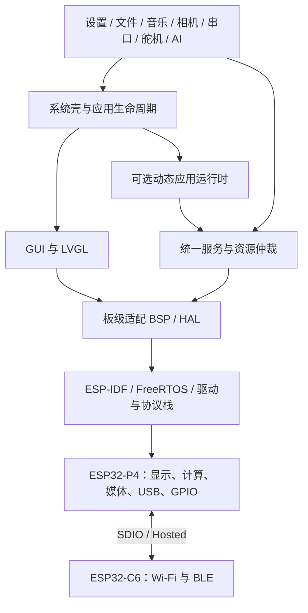
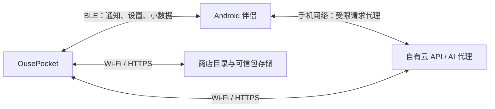

# 架构理解手册

这份文档帮助你在不亲自写代码的情况下，判断功能应该放在哪里、开发结果是否正确，以及出问题时该检查哪一层。以下服务名和接口示意为 OusePocket 的建议设计，除明确写出 Brookesia 类型外，不是上游现成 API。

## 1. 先建立整体认识

ESP-IDF 提供驱动、网络栈和 FreeRTOS。LVGL 把控件绘制到屏幕并处理触摸。Brookesia 组织系统壳、应用生命周期与可复用能力。OusePocket 在这些基础上定义自己的产品行为。

设备上的“应用”可以只是固件中的一组代码与界面，不必是独立进程。后台任务是 FreeRTOS 调度的执行单元；应用图标不是任务，关闭窗口也不会自动停止任务。传统 MCU 原生代码通常共享地址空间，某个应用的内存错误可能让整个系统崩溃。动态运行时的隔离强度要按具体后端验证。

这是产品建议分层图。旧 Phone 没有图中全部新 Runtime 能力；新 Brookesia 对应组件说明见 [官方 System Core](https://docs.espressif.com/projects/esp-brookesia/en/latest/system/core/index.html)。

## 2. 每一层应该负责什么

| 层 | 负责 | 你检查的重点 |
| --- | --- | --- |
| 驱动/ESP-IDF | UART、SPI、I2C、SDMMC、I2S、USB、网络、任务 | 硬件参数、错误码、时序、缓冲和实机证据 |
| BSP/HAL | 本板引脚、外设初始化、硬件抽象 | 一个外设由谁初始化；屏幕类型是否正确；引脚是否冲突 |
| 服务 | 音频、存储、Wi-Fi、BLE、GPIO、更新等共享能力 | 多应用共享是否一致；是否可取消；资源用完是否释放 |
| 系统 | 桌面、状态栏、前台切换、应用登记与生命周期 | 页面退出和后台工作策略，错误提示与恢复 |
| GUI | 文字、图标、布局、触摸和界面更新 | 320×480 可用性；中文显示；后台线程不直接乱改控件 |
| 应用 | 用户流程和业务逻辑 | 是否调用服务，而不是重复初始化驱动 |
| Runtime | 执行动态包，提供受控的宿主接口 | 后端资源限制、包兼容、权限边界与失败影响 |
| 手机/云 | 手机授权、代理、通知、包分发、AI | 谁持有身份/密钥，断线后系统怎样表现 |

你需要掌握的是层与层之间的**契约**：输入、输出、状态、事件、权限和失败行为。无需记住每个寄存器。

## 3. 用当前示例理解启动和应用

打开 `examples/esp-idf/11_esp_brookesia_phone/main/main.cpp`，按下面顺序读：

1. `bsp_display_start_with_config()`：启动显示与触摸相关板级能力。
2. `bsp_display_backlight_on()`：点亮背光；这还不是可持久化亮度设置。
3. `LvLock::registerCallbacks()`：告诉框架如何对 LVGL 操作加锁。
4. `new Phone()`：创建手机风格系统对象。
5. 选择 `STYLESHEET_320_480_DARK`：使用本板尺寸样式。
6. `phone->begin()`：启动系统壳。
7. `initAppFromRegistry()`、`installAppFromRegistry()`：初始化并登记固件中已有的应用。
8. 定时刷新状态栏时钟：本地时间显示不代表已联网校时。

旧应用基类在 `components/brookesia_core/systems/base/esp_brookesia_base_app.hpp`，有 `run`、`pause`、`resume`、`close` 等生命周期入口。`pause` 通常表示前台离开，但音乐可按产品策略继续播放；`close` 应释放应用持有的任务、回调和资源。具体行为由应用实现，名称本身不能证明资源已释放。

新路线改用 System Core/System Super 和对应 App/Runtime 接口，迁移时需要改生命周期与 GUI 集成，不能只改头文件名称。官方 System Core 统一管理原生与动态应用自己的 GUI、计时器等资源；参见 [服务与边界](https://docs.espressif.com/projects/esp-brookesia/en/latest/system/core/services.html)。

## 4. 四个关键调用流程

### 设置音量

用户拖动滑块 → Settings 发出音量请求 → Audio 服务限制范围并更新 codec → 返回实际值并广播事件 → UI 显示实际音量 → Settings 服务保存偏好。

播放器、USB 声卡与 AI 播报使用同一个音量状态。硬件写入失败时 UI 显示失败，不能先把新的值当成已生效。持久化采用节流/延迟写入，避免拖动每一像素都写 Flash。

### 后台播放音乐

用户选择文件 → Storage 检查路径和文件 → Audio 获取输出资源 → 后台任务读文件/解码/送 I2S → 通过事件报告进度 → GUI 只显示状态。退出页面移除界面订阅；是否停止播放由系统策略决定。USB 音频或 AI 播报要抢占/暂停时，由音频服务协调。

### Android 通知

手机 QQ/微信产生通知 → Android 伴侣获授权读取 → 按用户选择筛选 → BLE 分片发送 → 设备校验绑定与消息 ID → Notification 服务去重、保存有限条数 → 通知界面显示。

没有 Wi-Fi 也能做这个流程。云请求另走 Wi-Fi 或手机应用代理。连接断开时状态栏应显示“手机已断开”，而不是假装微信没有新消息。

### 安装一个应用包

商店获得目录 → 检查硬件/系统/服务版本 → 下载到暂存目录 → 校验大小、完整性、可信发布来源及包路径 → 解包并检查配额/依赖 → 切换有效版本 → System 注册 → Runtime 加载 → 用户启动。

下载成功不等于安装成功，安装成功不等于运行正常。失败时旧版本应保留。包代码、资源和用户数据分开，卸载时由用户决定是否清理个人数据。上游 `.bpk` 格式不应自行另造一套不兼容格式，扩展发布元数据前先核对官方规范。

## 5. 建议系统服务清单

| 服务 | 管理的对象 | 常见操作/事件示意 |
| --- | --- | --- |
| Display | 背光、屏幕状态 | 设置亮度、灭屏/唤醒；亮度变化 |
| Settings | 偏好与版本化配置 | 读写设置、恢复默认；配置变化 |
| Network | Wi-Fi、时间与可用传输 | 扫描/连接/重连；连接状态变化 |
| PhoneLink | BLE 配对与伴侣会话 | 绑定/解绑、请求/响应；断线与重连 |
| Notification | 通知缓存与隐私 | 接收/去重/清除；新通知 |
| Storage | SD 挂载、目录、应用数据 | 文件读写、容量；缺卡/读取错误 |
| Audio | codec、输入/输出与播放器 | 音量、录音/播放、暂停；进度/错误 |
| Camera/Media | 采集、缩略图与视频管线 | 拍照、预览、解码；帧/保存结果 |
| IO | 可用引脚、UART、PWM | 租用/释放、串口收发、停止 PWM；溢出/忙 |
| USB | 当前角色和设备模式 | 切换 CDC/UAC/网络；枚举/断开 |
| Update/Package | 固件与应用版本 | 检查、下载、验证、切换、恢复；进度 |
| Diagnostics/Power | 日志、资源指标、电池 | 查询状态、导出诊断、休眠；低电量 |
| Cloud/AI | 云请求、流式会话 | 提交/取消；结果/超时 |

这是产品接口分工。优先复用选定 Brookesia 版本已有服务，缺少的能力由适配器或自定义服务补齐。不要写出名称相同但数据契约不同的两套音频服务。

## 6. 资源所有权比图标更重要

| 资源 | 建议拥有者 | 冲突处理 |
| --- | --- | --- |
| LVGL 对象与界面更新 | GUI 线程/受控锁 | 工作任务通过消息交给 GUI，不能长时间占锁 |
| ES8311/I2S | Audio 服务 | 音乐、USB 和 AI 按策略暂停/拒绝/混音；先做简单互斥 |
| 摄像头与媒体缓冲 | Camera/Media 服务 | 限制并发，退出预览释放缓冲 |
| SD 挂载与文件操作 | Storage 服务 | 不允许各应用独立卸载卡；写文件有完整性策略 |
| UART/PWM/GPIO | IO 服务 | 按资源租约分配，正在桥接的 UART 不可同时被调试器占用 |
| USB 控制器 | USB 服务 | 切模式前停止旧管线并告知电脑重枚举 |
| C6 无线链路 | Hosted/Network/PhoneLink | 共享协处理器配置，测试 Wi-Fi/BLE 共存 |

NVS 适合少量设置，Flash 适合固件和恢复所需资源，SD 适合媒体和动态包。PSRAM 是易失运行内存，不能当作持久存储。PSRAM 充裕也不能忽略内部 SRAM 和 DMA 的要求。

## 7. 手机和云如何接入

设备到云和设备到手机是两条连接，各自有状态。不要把手机已绑定、Wi-Fi 已连接、互联网可达、云服务可用写成一个布尔值。云账号、设备身份和 BLE 绑定也不是同一个凭据。

手机代理只允许指定操作，不允许动态应用要求手机任意访问内网或任意 URL。设备凭证可撤销，日志不包含密码、完整通知或云密钥。下载包和媒体大文件优先 Wi-Fi，BLE 的吞吐策略根据实测决定。

## 8. 你如何掌控后续开发

要求每个功能交付都回答这些问题：

1. 用户看到什么变化？通过什么可复现操作验收？
2. 使用哪些服务？是否新增驱动初始化或共享状态？
3. 哪些资源被占用，退出/断线/失败时谁释放？
4. 在没有 Wi-Fi、SD、手机、摄像头时会怎样？
5. 是代码检查、编译通过，还是已在你的板上实际跑过？
6. 改了哪些版本/接口/数据格式，旧包与旧配置是否兼容？
7. 升级失败或新版本崩溃怎样回到可用状态？

把演示图标视为入口，把服务实测视为功能证据。一个天气页面没有真实数据通道，只完成 UI；一个 App Store 下载按钮没有验证与恢复，只完成下载流程。

建议学习顺序：先按第 3 节读启动流程，再画出设置音量的调用链，然后理解应用退出后的资源变化，最后理解应用包与整机 OTA 的区别。达到能解释“这个故障在哪层、应该提交哪些日志、怎么证明修好了”，你就具备系统掌控能力。

## 9. 后续工程组织建议

技术选型贴合 Ouse 的背景：Linux 云端优先 C# / ASP.NET Core；桌面调试、日志查看、刷写和应用发布工具优先 Avalonia，先评估复用 Crystal.Avalonia 的模块基础设施与 GOZA.Dock 的停靠布局。Web 管理页可用 Blazor 或 Svelte，AI 服务先评估 DotKernel。不要为本项目重建用户已有的模块框架、停靠库或 AI 内核；复用前核对具体接口与版本。

Android 伴侣的关键部分是系统通知服务、BLE 与后台生命周期，先验证这些原生能力。C# Android 或 Kotlin 的最终选择留到最小实验，不因桌面使用 Avalonia 就假定其界面层能替代 Android 系统服务。设备固件采用 ESP-IDF/C++，与 .NET 云端/上位机通过版本化协议互通。

产品工程可设 `firmware/`，统一服务设 `components/ouse_services/`，板级接入设 `components/ouse_board_adaptor/`，可信内置应用设 `components/ouse_apps/`，Android 伴侣设 `android/`，云端设 `cloud/`。这些目录目前只是规划，未创建实现。

微雪例程保持参考性质。新的板级适配尽量消费公开 BSP，不复制出多份驱动；沿用本仓库 `docs/components_ZH.md` 的托管组件维护策略。产品基线记录 IDF、Brookesia、LVGL、BSP、Hosted 主机与 C6 固件、P4 revision 的组合。每次只改变可定位的一组依赖，保存实物验证结果。

完成一个里程碑后更新 `00-project-context.md`：哪些建议已确认、哪些实测失败、实际版本是什么、下一步做什么。这样下一轮开发无需重新从聊天里推断产品意图。
