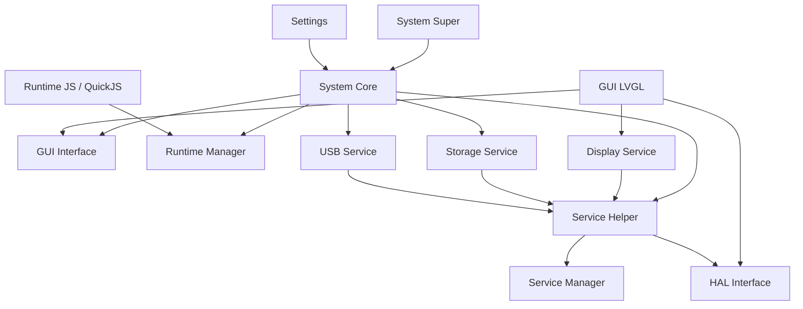

# Brookesia 源码体系：System Core 的依赖与四个核心组件

核对日期：2026-10-14。依据本仓库 `.reference/esp-brookesia` 的固定提交 `e937455b0db1a3e873b1da61d6d13652f3dcc7e2`。本篇解释源码与机制，不修改固件；“接口存在”不等于本板已经完成实机验证。

先记一句话：**System Core 是应用宿主；GUI 管界面，Runtime 执行应用代码，Storage 管数据，USB 把电脑上的文件送进设备。**

## 1. 桌面与设置共同依赖 System Core

```text
brookesia_system_super：默认桌面、启动器、状态栏
             ↓
brookesia_system_core：应用宿主
             ↑
brookesia_app_settings：设置应用
```

两者直接声明 System Core 依赖。工程加入桌面和设置以后，组件管理器会递归引入它，通常不用重复声明。

System Core 的直接依赖如下，以 [实际 manifest](../.reference/esp-brookesia/system/brookesia_system_core/idf_component.yml) 为准：

| 组件 | 依赖可见性 | System Core 使用它做什么 |
| --- | --- | --- |
| `brookesia_gui_interface` | public | 管应用自己的 GUI 文档、资源、显示层与后端契约 |
| `brookesia_runtime_manager` | public | 对接动态应用加载、执行后端与宿主桥 |
| `brookesia_service_helper` | public | 使用服务契约、调用辅助接口 |
| `brookesia_service_storage` | public | 访问文件和设置，组织应用存储布局 |
| `brookesia_service_usb` | private | 注册电脑端上传和 BPK 安装处理入口 |
| `zlib` | private | 解压 BPK 的 ZIP 数据 |

这里的 public/private 是构建依赖可见性，不是应用权限。public 会向使用本组件的上层传递相应构建依赖；private 主要由内部实现使用，但代码仍可能链接进固件。

注意职责边界：**存储布局和包安装流程由 System Core 组织；Storage 提供底层文件操作。** 不能把应用扫描、安装策略全归到 Storage。

## 2. 依赖图和运行链路是两回事

下面箭头表示主要构建依赖，省略部分工具库和交叉依赖，不是完整 manifest 图：



System Core 依赖 `GUI Interface`，启动工程再提供 `GUI LVGL` 实现；Runtime Manager 管后端，`Runtime JS` 再提供 QuickJS 执行器。这样的组合方式让上层不必把 LVGL 或 JS 引擎写死。

运行时的屏幕链路则是：

```text
应用 → SystemGui → GUI Interface → GUI LVGL → LVGL
                                            ↓ 显示输出
                      Display 服务 → Panel HAL → 微雪 BSP
```

## 3. 共享组件在 Flash 中怎样存在

每个源码组件通常包含：

```text
idf_component.yml：依赖名称、版本、来源
CMakeLists.txt：源文件、头文件、链接方式
Kconfig：功能开关与参数
include/：公开契约
src/：实现
```

编译时，各组件形成静态库 `.a`，再链接成整个系统的 `.elf`，最后生成固件 `.bin`。通常不会像桌面 DLL 那样在设备上分别安装这些组件。

动态应用的 `.bpk` 是另一回事：它主要装应用代码、manifest 和界面资源，调用固件中已有的服务，不附带另一份 LVGL 和屏幕驱动。

**依赖存在、代码被链接、插件被注册、服务运行中，是四个不同状态。** 当前关闭 Wi-Fi 自动注册后，桌面/设置的构建依赖中仍会出现 Wi-Fi；这不表示它已启动。

## 4. `brookesia_service_storage`：数据访问服务

### 它内部具备什么

| 能力 | 当前函数名示例 | 用于什么 |
| --- | --- | --- |
| 键值查询与写入 | `KVList`、`KVSet`、`KVGet`、`KVErase` | 偏好、开关、少量配置 |
| 存储卷发现与容量 | `GetFileSystems`、`GetFileSystemCapacity` | 找到可用 Flash/外部存储 |
| 文件与目录信息 | `FSStat`、`FSList` | 文件浏览、判断路径状态 |
| 创建、读取、写入 | `FSMkdir`、`FSReadText`、`FSWriteText`、`FSRead`、`FSWrite` | 文本和二进制数据 |
| 文件管理 | `FSRemove`、`FSRename`、`FSCopyTree` | 删除、移动、复制 |
| 名称适配 | `MakeKVKey`、`MakeKVNamespace` | 将较长业务名称映射到后端支持的名称 |

真实函数和参数契约见 [Storage Helper](../.reference/esp-brookesia/service/framework/brookesia_service_helper/include/brookesia/service_helper/system/storage.hpp)。

它是服务层，不是 SD 驱动，也不直接规定 SPI 引脚：

```text
应用 / System Core
       ↓ Storage 服务
KeyValueIface / FileSystemIface
       ↓ 具体 HAL 后端
NVS / LittleFS / FATFS 等
```

本工程使用 NVS 存设置、LittleFS 存界面资源和后续应用；SD 尚未接入该最小固件。Storage 运行成功不等于 SD 已经挂载。

### 如何调用

协议级调用示意，真实参数名称区分大小写：

```javascript
const storage = brookesia.start_service('Storage');
brookesia.call_function(storage, 'KVSet', JSON.stringify({
  Nspace: 'counter',
  KeyValuePairs: { Count: 12 }
}));
brookesia.stop_service(storage);
```

JS 应用还需在 manifest 中声明 Storage 服务依赖，按官方包规范填版本要求。没有声明的普通服务调用会受到 HostBridge 限制。这个片段用于解释调用方式，不是已经修改过的计数器代码。

底层 KV 支持 bool、int32 和 string。Helper 可以将更复杂类型序列化保存，这不表示 NVS 原生理解任意 C++ 对象。

NVS 后端名称长度有限；System Core 等上层会使用稳定哈希适配。因此日志里的 `using stable hash` 是兼容处理。首次读取尚未保存的 namespace/key 可以返回缺省状态。不能把这些警告直接认定为崩溃原因，也不能认为所有任意 KV 参数都无条件自动变成安全短名称。

### 它不负责什么

- 不执行应用代码，也不渲染界面。
- 不自动驱动 SD；需要已提供的存储 HAL。
- 文件系统服务本身不等于完整应用沙箱。System Core 的应用私有目录、HostBridge 路径检查和可信原生代码边界要另看。

源码入口：[服务实现](../.reference/esp-brookesia/service/system/brookesia_service_storage/src/service_storage.cpp)、[存储 HAL 接口](../.reference/esp-brookesia/hal/brookesia_hal_interface/include/brookesia/hal_interface/interfaces/storage/file_system.hpp)。

## 5. `brookesia_service_usb`：电脑控制与文件传输

名称容易误解：当前这个组件的主要用途是**通过 USB Serial/JTAG 或 UART 与电脑通信**，不是自动提供 USB 声卡、网卡或任意 OTG 外设驱动。

### 它内部具备什么

- 主机协议会话：连接握手、协议版本、状态、会话退出。
- 传输任务：接收数据帧、大小与 SHA-256 校验、暂存文件。
- 上传与安装命令，以及传输中止、超时和错误返回。
- 服务调用桥：电脑可以按 JSON 契约调用已注册的服务；RawBuffer 指针类参数不允许从电脑直接传入。
- 与日志共用串口时，控制会话期间协调日志输出，避免污染协议数据。

本板当前路径是：

```text
电脑 brookesia-usb
        ↓ USB-UART 桥 / COM10
P4 UART0 / 115200
        ↓ USB 服务
暂存文件 / 主机命令回调
```

### BPK 由谁真正安装

```text
电脑发送 BPK
  → USB 服务接收、校验、暂存
  → System Core 注册的 InstallBpk 回调
  → System Core 检查 manifest、服务要求、路径与资源
  → 解包到应用目录，注册应用
  → 以后用户打开时，由 Runtime 执行
```

因此：**USB 负责送进来，System Core 负责装进去，Runtime 负责跑起来。**

命令示意：

```powershell
brookesia-usb --port COM10 --baudrate 115200 status
brookesia-usb --port COM10 --baudrate 115200 install ./counter.bpk
```

关闭占用 COM10 的 monitor 再执行。配置中 console 与 USB 服务 transport 要使用同一物理串口。

传输散列验证完整性，不等于发布者身份验证；签名信任属于发布/安装策略。当前源码有暂存和失败清理逻辑，但不能据此承诺更新过程中任何断电都能自动保留旧版，产品级恢复还要单独验证。

源码入口：[USB 服务](../.reference/esp-brookesia/service/system/brookesia_service_usb/src/service_usb.cpp)、[官方电脑工具说明](../.reference/esp-brookesia/tools/brookesia_usb/README.md)、[System Core 桥接](../.reference/esp-brookesia/system/brookesia_system_core/src/system/lifecycle.cpp)。

## 6. `brookesia_gui_interface`：界面模型和界面运行时

它并非只有几个纯虚类。组件还包含解析、校验、资源与界面运行管理；“Interface”强调它不绑定某个具体渲染器。

| 内部部分 | 主要作用 |
| --- | --- |
| Document / Parser / Validator | 读取 JSON UI，形成并检查界面模型 |
| Resource | 管图片、字体等资源及其可见范围 |
| Runtime | 加载界面文档，挂载/卸载屏幕，驱动界面更新 |
| Binding / Data Store | 更新绑定值，让控件跟随业务数据变化 |
| Event / Action | 将控件事件转换成应用动作与订阅 |
| Screen Flow | 管一个应用内的页面进入与切换 |
| Theme / Language | 应用主题与语言资源 |
| Backend 契约 | 将已解析的模型交给具体渲染后端 |

这里的 GUI Runtime 是“界面运行管理”，不是执行 JavaScript 的 Runtime Manager。

实际 [GUI Runtime](../.reference/esp-brookesia/gui/brookesia_gui_interface/include/brookesia/gui_interface/runtime.hpp) 提供 `set_theme`、`set_language`、`mount_screen`、`unmount_screen`、`set_binding_value` 和事件订阅等能力。产品系统使用它组织文档；普通应用经 System Core 的应用上下文操作自己的界面。

一段界面定义：

```json
{
  "type": "viewScreen",
  "id": "main",
  "children": [{
    "type": "label",
    "id": "value",
    "labelProps": { "text": "0" }
  }]
}
```

JS 更新这个标签：

```javascript
const gui = brookesia.start_service('SystemGui');
brookesia.call_function(gui, 'SetText', JSON.stringify({
  Path: '/main/value', Text: '12'
}));
// 应用停止时释放 gui 句柄。
```

`SystemGui` 是 System Core 提供给应用的受控入口；它把调用者关联到自己的文档。GUI Interface 本身不是服务名 SystemGui，两者不能混为同一个类库。

`brookesia_gui_lvgl` 实现后端，将模型转成 LVGL 对象。屏幕像素、触摸与 DMA 连接则由 DisplaySource/Display/HAL 完成。GUI Interface 不直接初始化微雪 ST7796。

## 7. `brookesia_runtime_manager`：执行后端的统一管理器

### 它内部具备什么

- 查找已注册的后端，选择 JavaScript/Lua/WASM/ELF 等具体实现。
- 持有动态应用记录与应用 ID。
- 加载、启动、停止、卸载应用。
- 调用应用导出的函数。
- 管宿主桥与原生函数/值，让应用能够调用设备提供的能力。

真实 [Runtime 类](../.reference/esp-brookesia/runtime/brookesia_runtime_manager/include/brookesia/runtime_manager/runtime.hpp) 的关键入口：

```cpp
init();
load_app(config);
start_app(id);
call_function(id, module_name, function_name, args);
stop_app(id);
unload_app(id);
```

这是 API 导读片段，不是完整调用程序。每一步要检查 `std::expected` 结果。

### 它与 System Core 的分工

```text
System Core：这个应用的名称、图标、界面、数据目录、系统生命周期
Runtime Manager：这个动态应用交给哪个执行后端，如何调用代码
Runtime JS：实际用 QuickJS 解释 JavaScript
```

System Core 的 AppId 与 Runtime 内部 ID 不应假定完全相同，上层有记录和关联。

打开计数器的流程：

```text
点击图标
 → System Core 准备应用自己的 GUI
 → 根据 manifest 选择 JavaScript 后端
 → Runtime 加载入口 app/main.js
 → 调用 brookesia_app.on_start()
 → JS 经 HostBridge 调用 SystemGui
```

Runtime Manager 不负责把 ZIP 包下载到设备，也不负责画默认桌面。Runtime JS 是否可用，取决于该具体后端是否已编译、注册并初始化。

当前 JS 后端为应用创建各自的 QuickJS runtime/context，并设置内存与栈限制；通过 System Core HostBridge 的界面、计时器和服务访问也有边界。但固件原生代码共享地址空间，这不能等同 PC 的进程隔离或恶意代码强沙箱。

## 8. 把四个组件串起来

```text
安装：电脑 → USB → System Core → Storage/文件系统
打开：桌面 → System Core → Runtime Manager → Runtime JS
显示：JS → SystemGui → GUI Interface → GUI LVGL → Display → HAL
保存：JS → Storage → KV/文件 HAL → NVS/LittleFS
```

一次只沿一条链看源码。比如读“更新标签”时，先不读 USB 接收和 ZIP 解包，会容易很多。

参考源码根目录需要运行 `tools/prepare-brookesia.ps1` 后才存在；它被 Git 忽略，链接不是已提交的第三方源码。官方概览可交叉阅读 [Brookesia 编程指南](https://docs.espressif.com/projects/esp-brookesia/zh_CN/latest/)。
