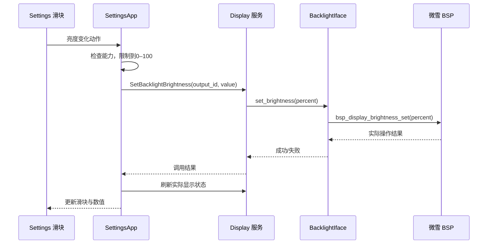

# Settings 配置指南：接入、硬件能力、界面与持久化

核对日期：2026-10-14。依据 Brookesia 固定提交 `e937455b0db1a3e873b1da61d6d13652f3dcc7e2`。本篇提供接口导读和配置示例，没有改动工程配置。

**Settings 是一个内置 C++ 应用，不是给系统一次性填完所有功能的配置文件。** 你分别配置板级能力、服务、系统，再让 Settings 使用它们。

当前目标仍是先稳定显示默认桌面。计数器保持独立包；Wi-Fi 已关闭自动注册。最新完整实机日志（ELF SHA256 前缀 `9b5e486ab`）已启动桌面，并完成 Settings 打开、退出和页面切换，本次记录未出现非法访问。此前堆分配器 Load access fault 尚未定位，不能据一次成功启动认定长期稳定。

## 1. 四种“配置”分别在哪

| 你要配置什么 | 所在位置 | 例子 |
| --- | --- | --- |
| 引入设置应用 | `main/idf_component.yml` / 构建组件 | `brookesia_app_settings` |
| 接入设备能力 | BSP / HAL，相关 Kconfig | 显示、背光、音频 codec、C6 Wi-Fi |
| 构建参数 | `sdkconfig.defaults`、当前 `sdkconfig` | Settings 预加载、Wi-Fi 服务是否注册 |
| 用户运行时偏好 | Settings 操作，保存至 Storage 后端 | 亮度、语言、主题、Wi-Fi 开关 |

`sdkconfig.defaults` 提供初始默认值；已有 `sdkconfig` 不会因为 defaults 改了一行就一定覆盖旧值。运行时亮度等偏好也不需要重新编译固件。

## 2. 怎样把 Settings 放到桌面

### 第一步：加入组件

当前最小工程采用下面这种声明，从同一份最新源码快照读取组件：

```yaml
dependencies:
  espressif/brookesia_app_settings:
    version: "0.8.*"
    override_path: ../../../.reference/esp-brookesia/app/brookesia_app_settings
```

路径相对 `main/idf_component.yml`，不是任意工程都能复制这个相对路径。组件自动引入 System Core、Device、Storage、Wi-Fi、SNTP 和 HAL 接口等依赖；清单见 [Settings manifest](../.reference/esp-brookesia/app/brookesia_app_settings/idf_component.yml)。

组件目录的 `package/res/` 是 Settings 的 JSON、图片和语言资源。构建脚本会把资源加入应用 staging，再与桌面资源一起生成 LittleFS 图像。

### 第二步：保留应用 provider 并让系统安装它

Settings 是 `SettingsApp : system::core::IApp`，有应用 metadata、GUI descriptor 和生命周期。官方组件 CMake 已用 `-u app_settings_provider_symbol` 保留它的原生应用 provider；因此一般不用自己重新注册第二份 Settings。

System Core 配置中的 `install_registered_apps` 默认为 true，负责安装这些已注册原生应用。System Super 再把可见应用放进启动器。

```text
Settings 组件链接并保留 provider
 → System 安装已注册应用
 → 读取 get_manifest() 和 get_gui_descriptor()
 → System Super 显示 Settings 图标
```

若关掉自动安装，就需要自己显式安装应用；不能同时自动安装和手工重复安装同 ID。

### 第三步：界面资源必须实际烧到设备

本工程完整 `flash` 写系统固件与 LittleFS 资源；只有 `app-flash` 不会更新 Settings 的 JSON、图片、字体。修改资源之后，要安排对应资源分区更新，注意保存已有应用数据。

源码入口：[Settings 公开类](../.reference/esp-brookesia/app/brookesia_app_settings/include/brookesia/app_settings/settings_app.hpp)、[资源与 provider 打包](../.reference/esp-brookesia/app/brookesia_app_settings/cmake/esp_platform.cmake)。

## 3. 每个设置项需要什么能力

| 设置 | 依赖的运行时能力 | 本板目前状态 |
| --- | --- | --- |
| 屏幕亮度 | Display 服务 + BacklightIface | HAL 与 LVGL 已成功启动，完整交互仍待稳定运行验证 |
| 音量/静音 | AudioPlayback 服务 + 音频 HAL/codec | 最小固件没有接入 |
| Wi-Fi | Wi-Fi 服务 + Wi-Fi HAL + C6/Hosted | 当前关闭服务自动注册 |
| 语言 | 系统 GUI 语言、i18n 资源、匹配字体 | `zh_CN` 偏好保存成功；重启后中文显示待验证 |
| 主题 | 系统主题资源与 GUI 主题更新 | `dark` 偏好保存成功；重启后主题显示待验证 |
| 设备信息 | Device 服务与可用 HAL 信息 | 当前日志确认 Board info 接口缺失 |
| 重启 | System HAL 的 GeneralIface | 当前 System Device 关闭，Settings 重启接口不可用 |
| 时区/校时 | SNTP 服务与网络能力 | 不因页面存在就具备联网校时 |
| 蓝牙 | 需要额外手机链路/蓝牙功能与 UI | 不能把当前 Settings 当成已完成的蓝牙配对中心 |

Settings 会检查部分服务是否存在、硬件能力是否支持，再刷新可用状态。缺少服务时可能显示不可用、禁用操作或记录日志；不是所有入口都自动从界面消失。

## 4. 用亮度设置理解完整调用链



源码 [service/device.ipp](../.reference/esp-brookesia/app/brookesia_app_settings/src/service/device.ipp) 的调用核心如下，省略外围检查：

```cpp
auto result = DisplayHelper::call_function_sync(
    DisplayHelper::FunctionId::SetBacklightBrightness,
    static_cast<double>(output_id),
    static_cast<double>(brightness),
    service::helper::Timeout(1000)
);
```

`output_id` 来自 Display 的输出列表，不是 GPIO 编号；只有一个屏幕时也应使用查询出的 ID。

底层适配则把操作交给微雪驱动：

```cpp
bool set_brightness(uint8_t percent) override
{
    return bsp_display_brightness_set(percent) == ESP_OK;
}
```

这只是接口示意；本工程实际还处理 10% 下限、背光开关和缓存状态。Settings 自己限制到0–100，硬件适配层可能进一步限制，所以验收要看真实背光/返回状态，不能只看滑块变化。

当前 Display 服务有亮度/开关状态的 Storage 保存和加载逻辑。以后重启是否恢复，应通过实物验证；Settings 不需要重复维护另一份独立背光驱动。

## 5. 音量、Wi-Fi、主题和语言怎样接

### 音量与静音

Settings 已有 `SetVolume` / `SetMute` 调用路径。后续接入 AudioPlayback 服务、ES8311 与 I2S HAL，再确认 playback 能力可用，就能复用这些 UI 操作。

不要在 Settings 中单独再初始化 ES8311。播放器、AI 播报和 Settings 应访问同一套音频服务，否则音量状态容易不一致。

### Wi-Fi

Settings 启动/安装时会判断 Wi-Fi 服务是否可用，绑定服务并读取 Wi-Fi 开关偏好。它还有扫描、连接、列表分页和事件更新等代码。

当前为了先显示桌面，配置是：

```text
CONFIG_BROOKESIA_HAL_ADAPTOR_ENABLE_WIFI_DEVICE=n
CONFIG_BROOKESIA_SERVICE_WIFI_ENABLE_AUTO_REGISTER=n
```

后续不能只把第二行改成 y。要先配置 C6/Hosted、对应引脚/总线与 HAL，验证联网，再注册服务。否则会回到“Wi-Fi basic HAL interface is not available”的错误。

### 主题和语言

当前版本 Settings 通过应用 GUI 上下文同步保存主题/语言偏好，再弹出重启确认；System Super 在后续启动时读取偏好，资源中要有 theme/i18n/font 支持。这里不能把“偏好保存成功”理解成“当前所有页面已经即时切换”。

最新实机日志已出现 `ThemeId: dark` 和 `Language: zh_CN` 保存成功。Settings 启动时也报告 `Settings restart interface is unavailable`：当前 `BROOKESIA_HAL_ADAPTOR_ENABLE_SYSTEM_DEVICE` 关闭，无法取得 `hal::system::GeneralIface`。源码中点击“立即重启”在接口为空时会显示重启失败提示；开关主题/语言后反复看到弹窗并不等于内存崩溃。接入系统 HAL 的 Restart 实现后再验证重启流程；本篇没有应用配置修改。

相关代码在 [i18n/language_theme.ipp](../.reference/esp-brookesia/app/brookesia_app_settings/src/i18n/language_theme.ipp)。语言变成 `zh_CN` 不等于任意通知汉字都能显示，字体仍有字形覆盖范围。

不要只修改某个标签文本来“切换系统语言”，否则桌面、Settings 和其他应用不会保持一致。

## 6. Settings 自己有哪些构建参数

当前 [Kconfig](../.reference/esp-brookesia/app/brookesia_app_settings/Kconfig) 中较容易理解的参数：

| 配置 | 默认值 | 意义 |
| --- | --- | --- |
| `BROOKESIA_APP_SETTINGS_WIFI_MAX_VISIBLE_APS` | 5 | 每页显示多少个 Wi-Fi AP，不是扫描只返回5个 |
| `BROOKESIA_APP_SETTINGS_ENABLE_PRELOAD_DOM` | y | 安装时预加载并保留 Settings 的界面文档，加快打开速度但增加驻留内存 |
| `BROOKESIA_APP_SETTINGS_ENABLE_MEMORY_TRACE` | n | Wi-Fi 列表等流程的内存分析日志 |
| `BROOKESIA_APP_SETTINGS_ENABLE_PROFILE_LOG` | 通常 n | 启动阶段耗时日志 |

还有 Debug 页的采样间隔、内存阈值、线程分析范围等参数。它们不是设置实际亮度/音量的入口。

配置示例，仅供后续选择：

```text
CONFIG_BROOKESIA_APP_SETTINGS_WIFI_MAX_VISIBLE_APS=5
CONFIG_BROOKESIA_APP_SETTINGS_ENABLE_PRELOAD_DOM=n
CONFIG_BROOKESIA_APP_SETTINGS_ENABLE_PROFILE_LOG=y
```

关预加载会把解析开销转移到打开 Settings 时，并不是完全取消它的界面解析。当前崩溃不能只因日志靠近某个安装阶段，就认定预加载有 bug；要结合堆完整性和调用栈验证。本篇没有应用这些示例配置。

## 7. 界面在哪里，新增设置项怎么做

```text
app/brookesia_app_settings/
  include/.../settings_app.hpp     应用类与生命周期声明
  src/app/lifecycle.ipp            安装、启动、停止与动作分发
  src/service/device.ipp           亮度、音量、静音
  src/service/wifi.ipp             Wi-Fi 操作
  src/i18n/language_theme.ipp      语言和主题
  package/res/screens/            页面
  package/res/templates/          可复用控件
  package/res/flows/              页面流程
  package/res/i18n/               翻译文本
  package/res/constants/          布局常量/分辨率适配
```

部分 `.cpp` 通过 include `.ipp` 组织实现，这是代码拆分方式；阅读某个 `.cpp` 只有几行时，要继续看它 include 的 `.ipp`。

如果将来增加“串口默认波特率”，建议步骤是：

1. 定义偏好字段、默认值和有效范围，决定由你的 IO/Settings 服务保存。
2. 在页面 JSON 添加控件和唯一动作名，添加中英文翻译。
3. 在 Settings 的动作处理路径中读取值、校验，并调用你的服务。
4. 从服务读取实际状态刷新 UI；失败时有明确反馈。
5. 通过 Storage 保存，重新进入页面/重启时恢复。

不要只画一个能拖动的控件。是否完成的判据是“硬件或业务状态实际改变，失败有处理，重新打开读回正确状态”。

正式扩展时优先在自己的产品组件中定义业务服务，明确维护的 Settings 扩展或分支；不要无记录修改下载的 managed component，否则依赖刷新可能覆盖修改。当前 reference 是固定源码快照，也要区分上游与产品改动。

## 8. 最小接入检查表

- 组件已链接，Settings provider 被保留，系统未关闭原生应用自动安装。
- LittleFS 已挂载，并有 Settings/系统 JSON、图片与字体资源。
- GUI Backend/DisplaySource 已初始化，显示输出与触摸分组正确。
- 亮度需要背光 HAL；音量需要音频服务；Wi-Fi 需要 C6/Hosted 与网络 HAL。
- 缺省配置、自动注册、用户保存的偏好分别检查，避免把它们当成一套配置。
- 实机验收包括：打开/退出 Settings、真实亮度变化、重启恢复、缺少服务时可正常返回桌面。

先读 [System Core 和四个组件](05-brookesia-core-components.md)，再沿亮度链读本篇。官方 Settings 源码入口为 [brookesia_app_settings](https://github.com/espressif/esp-brookesia/tree/e937455b0db1a3e873b1da61d6d13652f3dcc7e2/app/brookesia_app_settings)。
