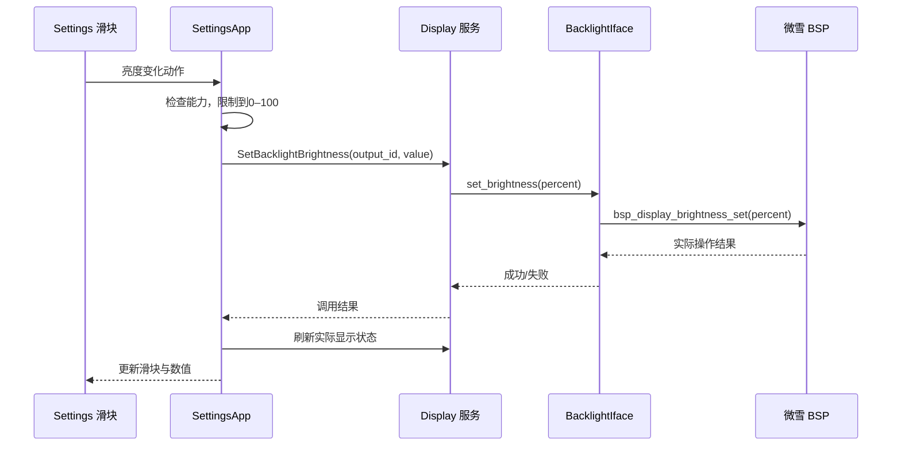

# Settings 配置指南：接入、硬件能力、界面与持久化

核对日期：2026-10-14。依据 Brookesia 固定提交 `e937455b0db1a3e873b1da61d6d13652f3dcc7e2`。实际工程已新增本地 Settings 分支；本次接入状态和验证步骤见第9节。

**Settings 是一个内置 C++ 应用，不是给系统一次性填完所有功能的配置文件。** 你分别配置板级能力、服务、系统，再让 Settings 使用它们。

当前目标仍是先稳定显示默认桌面。计数器保持独立包；Wi-Fi 已关闭自动注册。最新完整实机日志（ELF SHA256 前缀 `9b5e486ab`）已启动桌面，并完成 Settings 打开、退出和页面切换，本次记录未出现非法访问。此前堆分配器 Load access fault 尚未定位，不能据一次成功启动认定长期稳定。

## 1. 四种“配置”分别在哪

Settings 对应独立组件 `brookesia_app_settings`，组件内实现一个原生 C++ 应用。可以选择加入或不加入；官方桌面并不强制同时安装 Settings。

| 想管理的内容 | 修改位置 |
| --- | --- |
| 预加载、分析日志、Wi-Fi每页显示数量等开发参数 | Kconfig / sdkconfig |
| 页面是否有某个选项、布局、控件、翻译 | `package/res/` 下的 JSON |
| 点击后调用什么、输入校验、状态刷新、偏好保存 | `src/` 下的 C++ / `.ipp` |

`sdkconfig` 没有统一开关让你任意组合“隐藏声音、添加DPI、添加蓝牙”这些页面。新增设置通常同时修改 JSON 和 C++，并接入该选项需要的服务。

| 你要配置什么 | 所在位置 | 例子 |
| --- | --- | --- |
| 引入设置应用 | `main/idf_component.yml` / 构建组件 | `brookesia_app_settings` |
| 接入设备能力 | BSP / HAL，相关 Kconfig | 显示、背光、音频 codec、C6 Wi-Fi |
| 构建参数 | `sdkconfig.defaults`、当前 `sdkconfig` | Settings 预加载、Wi-Fi 服务是否注册 |
| 用户运行时偏好 | Settings 操作，保存至 Storage 后端 | 亮度、语言、主题、Wi-Fi 开关 |

`sdkconfig.defaults` 提供初始默认值；已有 `sdkconfig` 不会因为 defaults 改了一行就一定覆盖旧值。运行时亮度等偏好也不需要重新编译固件。

## 2. 怎样把 Settings 放到桌面

### 第一步：加入组件

当前最小工程采用下面这种声明，从同一份最新源码快照读取组件：

```yaml
dependencies:
  espressif/brookesia_app_settings:
    version: "0.8.*"
    override_path: ../../../components/brookesia_app_settings
```

路径相对 `main/idf_component.yml`，不是任意工程都能复制这个相对路径。组件自动引入 System Core、Device、Storage、Wi-Fi、SNTP 和 HAL 接口等依赖；清单见 [Settings manifest](../.reference/esp-brookesia/app/brookesia_app_settings/idf_component.yml)。

组件目录的 `package/res/` 是 Settings 的 JSON、图片和语言资源。构建脚本会把资源加入应用 staging，再与桌面资源一起生成 LittleFS 图像。

### 第二步：保留应用 provider 并让系统安装它

Settings 是 `SettingsApp : system::core::IApp`，有应用 metadata、GUI descriptor 和生命周期。官方组件 CMake 已用 `-u app_settings_provider_symbol` 保留它的原生应用 provider；因此一般不用自己重新注册第二份 Settings。

System Core 配置中的 `install_registered_apps` 默认为 true，负责安装这些已注册原生应用。System Super 再把可见应用放进启动器。

```text
Settings 组件链接并保留 provider
 → System 安装已注册应用
 → 读取 get_manifest() 和 get_gui_descriptor()
 → System Super 显示 Settings 图标
```

若关掉自动安装，就需要自己显式安装应用；不能同时自动安装和手工重复安装同 ID。

### 第三步：界面资源必须实际烧到设备

本工程完整 `flash` 写系统固件与 LittleFS 资源；只有 `app-flash` 不会更新 Settings 的 JSON、图片、字体。修改资源之后，要安排对应资源分区更新，注意保存已有应用数据。

源码入口：[Settings 公开类](../.reference/esp-brookesia/app/brookesia_app_settings/include/brookesia/app_settings/settings_app.hpp)、[资源与 provider 打包](../.reference/esp-brookesia/app/brookesia_app_settings/cmake/esp_platform.cmake)。

## 3. 每个设置项需要什么能力

当前官方页面包含：亮度、浅色/深色主题、音量/静音、Wi-Fi开关/扫描/连接/断开与已保存网络、语言、时区与校时状态、设备信息，以及内存/线程/GUI调试。当前没有现成的 DPI/字体大小、蓝牙配对、应用安装卸载或SD管理设置页。

下面是本次接入改动前的初版实机状态。本板已实测的是：桌面与 Settings 启动、打开/退出、页面切换、主题和语言偏好保存。亮度 HAL 已接入，实际滑块调节待专项验收；不能把所有页面都记成已完成功能。

| 设置 | 依赖的运行时能力 | 本板目前状态 |
| --- | --- | --- |
| 屏幕亮度 | Display 服务 + BacklightIface | HAL 与 LVGL 已成功启动，完整交互仍待稳定运行验证 |
| 音量/静音 | AudioPlayback 服务 + 音频 HAL/codec | 最小固件没有接入 |
| Wi-Fi | Wi-Fi 服务 + Wi-Fi HAL + C6/Hosted | 当前关闭服务自动注册 |
| 语言 | 系统 GUI 语言、i18n 资源、匹配字体 | `zh_CN` 偏好保存成功；重启后中文显示待验证 |
| 主题 | 系统主题资源与 GUI 主题更新 | `dark` 偏好保存成功；重启后主题显示待验证 |
| 设备信息 | Device 服务与可用 HAL 信息 | 当前日志确认 Board info 接口缺失 |
| 重启 | System HAL 的 GeneralIface | 当前 System Device 关闭，Settings 重启接口不可用 |
| 时区/校时 | SNTP 服务与网络能力 | 不因页面存在就具备联网校时 |
| 蓝牙 | 需要额外手机链路/蓝牙功能与 UI | 不能把当前 Settings 当成已完成的蓝牙配对中心 |

Settings 会检查部分服务是否存在、硬件能力是否支持，再刷新可用状态。缺少服务时可能显示不可用、禁用操作或记录日志；不是所有入口都自动从界面消失。

## 4. 用亮度设置理解完整调用链



源码 [service/device.ipp](../.reference/esp-brookesia/app/brookesia_app_settings/src/service/device.ipp) 的调用核心如下，省略外围检查：

```cpp
auto result = DisplayHelper::call_function_sync(
    DisplayHelper::FunctionId::SetBacklightBrightness,
    static_cast<double>(output_id),
    static_cast<double>(brightness),
    service::helper::Timeout(1000)
);
```

`output_id` 来自 Display 的输出列表，不是 GPIO 编号；只有一个屏幕时也应使用查询出的 ID。

底层适配则把操作交给微雪驱动：

```cpp
bool set_brightness(uint8_t percent) override
{
    return bsp_display_brightness_set(percent) == ESP_OK;
}
```

这只是接口示意；本工程实际还处理 10% 下限、背光开关和缓存状态。Settings 自己限制到0–100，硬件适配层可能进一步限制，所以验收要看真实背光/返回状态，不能只看滑块变化。

当前 Display 服务有亮度/开关状态的 Storage 保存和加载逻辑。以后重启是否恢复，应通过实物验证；Settings 不需要重复维护另一份独立背光驱动。

## 5. 音量、Wi-Fi、主题和语言怎样接

### 音量与静音

Settings 已有 `SetVolume` / `SetMute` 调用路径。后续接入 AudioPlayback 服务、ES8311 与 I2S HAL，再确认 playback 能力可用，就能复用这些 UI 操作。

初版不能调节声音有两层原因：最小工程没有引入并注册 `brookesia_service_audio` 提供的 AudioPlayback 服务，而且音频 HAL 未接入。日志对应 `AudioPlayback service is not registered; audio controls will stay disabled`。本次使用微雪自定义音频 HAL，官方 Board Manager 音频设备仍关闭，详见第9节。

后续流程是：引入音频组件 → 按本板配置 codec/I2S及Playback HAL → 注册并启动 AudioPlayback → 播放测试音频 → 验证 Settings 音量和静音。只打开音频 Kconfig 不保证微雪的硬件参数已经配置正确。

Settings 当前声音页提供音量和静音，没有现成的均衡器、混响或提示音选择。“调音量”与“设置音效”是不同功能，音效处理需另行实现。

不要在 Settings 中单独再初始化 ES8311。播放器、AI 播报和 Settings 应访问同一套音频服务，否则音量状态容易不一致。

### Wi-Fi

Settings 启动/安装时会判断 Wi-Fi 服务是否可用，绑定服务并读取 Wi-Fi 开关偏好。它还有扫描、连接、列表分页和事件更新等代码。

初版为了先显示桌面，曾使用以下配置；本次已启用 Wi-Fi：

```text
CONFIG_BROOKESIA_HAL_ADAPTOR_ENABLE_WIFI_DEVICE=n
CONFIG_BROOKESIA_SERVICE_WIFI_ENABLE_AUTO_REGISTER=n
```

后续不能只把第二行改成 y。要先配置 C6/Hosted、对应引脚/总线与 HAL，验证联网，再注册服务。否则会回到“Wi-Fi basic HAL interface is not available”的错误。

### 主题和语言

当前版本 Settings 通过应用 GUI 上下文同步保存主题/语言偏好，再弹出重启确认；System Super 在后续启动时读取偏好，资源中要有 theme/i18n/font 支持。这里不能把“偏好保存成功”理解成“当前所有页面已经即时切换”。

最新实机日志已出现 `ThemeId: dark` 和 `Language: zh_CN` 保存成功。Settings 启动时也报告 `Settings restart interface is unavailable`：当前 `BROOKESIA_HAL_ADAPTOR_ENABLE_SYSTEM_DEVICE` 关闭，无法取得 `hal::system::GeneralIface`。源码中点击“立即重启”在接口为空时会显示重启失败提示；开关主题/语言后反复看到弹窗并不等于内存崩溃。接入系统 HAL 的 Restart 实现后再验证重启流程；本篇没有应用配置修改。

需要启用的系统能力配置如下，仅供后续修改参考；应同步检查当前 `sdkconfig` 与 defaults：

```text
CONFIG_BROOKESIA_HAL_ADAPTOR_ENABLE_SYSTEM_DEVICE=y
CONFIG_BROOKESIA_HAL_ADAPTOR_SYSTEM_ENABLE_RESTART_IMPL=y
```

这条链是 Settings → `GeneralIface::restart()` → 平台 Restart 实现，不依赖 Wi-Fi。当前最小工程关闭 System Device 是为了减少首次接入的能力范围，造成 Settings 的重启接口缺失；不是主板不支持软件重启。

### DPI与字体缩放

System Core 初始化配置包含 GUI 的 `Environment`，可指定逻辑缩放：

```cpp
config.core_config.environment = {
    .width_px = 320,
    .height_px = 480,
    .density = 1.0F,
    .font_scale = 1.0F,
};
```

`dp × density` 换算成像素，`sp × density × font_scale` 换算字体尺寸；固定px不随它缩放，也不会改变屏幕物理分辨率。当前没有统一运行时设置密度的 System Core 入口或 Settings DPI滑块。若要添加，可以在JSON增加选项、C++校验并保存数值、系统启动时读取并填入environment，再提示重启生效。还需验证桌面布局和字体是否适配新的比例。

相关代码在 [i18n/language_theme.ipp](../.reference/esp-brookesia/app/brookesia_app_settings/src/i18n/language_theme.ipp)。语言变成 `zh_CN` 不等于任意通知汉字都能显示，字体仍有字形覆盖范围。

不要只修改某个标签文本来“切换系统语言”，否则桌面、Settings 和其他应用不会保持一致。

## 6. Settings 自己有哪些构建参数

当前 [Kconfig](../.reference/esp-brookesia/app/brookesia_app_settings/Kconfig) 中较容易理解的参数：

| 配置 | 默认值 | 意义 |
| --- | --- | --- |
| `BROOKESIA_APP_SETTINGS_WIFI_MAX_VISIBLE_APS` | 5 | 每页显示多少个 Wi-Fi AP，不是扫描只返回5个 |
| `BROOKESIA_APP_SETTINGS_ENABLE_PRELOAD_DOM` | y | 安装时预加载并保留 Settings 的界面文档，加快打开速度但增加驻留内存 |
| `BROOKESIA_APP_SETTINGS_ENABLE_MEMORY_TRACE` | n | Wi-Fi 列表等流程的内存分析日志 |
| `BROOKESIA_APP_SETTINGS_ENABLE_PROFILE_LOG` | 通常 n | 启动阶段耗时日志 |

还有 Debug 页的采样间隔、内存阈值、线程分析范围等参数。它们不是设置实际亮度/音量的入口。

配置示例，仅供后续选择：

```text
CONFIG_BROOKESIA_APP_SETTINGS_WIFI_MAX_VISIBLE_APS=5
CONFIG_BROOKESIA_APP_SETTINGS_ENABLE_PRELOAD_DOM=n
CONFIG_BROOKESIA_APP_SETTINGS_ENABLE_PROFILE_LOG=y
```

关预加载会把解析开销转移到打开 Settings 时，并不是完全取消它的界面解析。当前崩溃不能只因日志靠近某个安装阶段，就认定预加载有 bug；要结合堆完整性和调用栈验证。本篇没有应用这些示例配置。

## 7. 界面在哪里，新增设置项怎么做

```text
app/brookesia_app_settings/
  include/.../settings_app.hpp     应用类与生命周期声明
  src/app/lifecycle.ipp            安装、启动、停止与动作分发
  src/service/device.ipp           亮度、音量、静音
  src/service/wifi.ipp             Wi-Fi 操作
  src/i18n/language_theme.ipp      语言和主题
  package/res/screens/            页面
  package/res/templates/          可复用控件
  package/res/flows/              页面流程
  package/res/i18n/               翻译文本
  package/res/constants/          布局常量/分辨率适配
```

部分 `.cpp` 通过 include `.ipp` 组织实现，这是代码拆分方式；阅读某个 `.cpp` 只有几行时，要继续看它 include 的 `.ipp`。

如果将来增加“串口默认波特率”，建议步骤是：

1. 定义偏好字段、默认值和有效范围，决定由你的 IO/Settings 服务保存。
2. 在页面 JSON 添加控件和唯一动作名，添加中英文翻译。
3. 在 Settings 的动作处理路径中读取值、校验，并调用你的服务。
4. 从服务读取实际状态刷新 UI；失败时有明确反馈。
5. 通过 Storage 保存，重新进入页面/重启时恢复。

不要只画一个能拖动的控件。是否完成的判据是“硬件或业务状态实际改变，失败有处理，重新打开读回正确状态”。

正式扩展时优先在自己的产品组件中定义业务服务，明确维护的 Settings 扩展或分支；不要无记录修改下载的 managed component，否则依赖刷新可能覆盖修改。当前 reference 是固定源码快照，也要区分上游与产品改动。

## 8. 最小接入检查表

- 组件已链接，Settings provider 被保留，系统未关闭原生应用自动安装。
- LittleFS 已挂载，并有 Settings/系统 JSON、图片与字体资源。
- GUI Backend/DisplaySource 已初始化，显示输出与触摸分组正确。
- 亮度需要背光 HAL；音量需要音频服务；Wi-Fi 需要 C6/Hosted 与网络 HAL。
- 缺省配置、自动注册、用户保存的偏好分别检查，避免把它们当成一套配置。
- 实机验收包括：打开/退出 Settings、真实亮度变化、重启恢复、缺少服务时可正常返回桌面。

先读 [System Core 和四个组件](05-brookesia-core-components.md)，再沿亮度链读本篇。官方 Settings 源码入口为 [brookesia_app_settings](https://github.com/espressif/esp-brookesia/tree/e937455b0db1a3e873b1da61d6d13652f3dcc7e2/app/brookesia_app_settings)。

## 9. 当前接入：重启、声音、Wi-Fi和DPI

状态：已修改代码和defaults/当前sdkconfig，未编译、未烧录、未实机验证。已完成清单保持初版结果。

| 能力 | 本次实现 |
| --- | --- |
| 重启 | 启用System Device与Restart实现，复用Settings现有重启确认 |
| 声音 | 新增微雪BSP/ES8311 CodecPlayer及Playback HAL，接入AudioPlayback、音量/静音和测试音按钮 |
| Wi-Fi | 启用官方Wi-Fi HAL/服务、Remote Wi-Fi和ESP-Hosted 2.12.3，Settings复用原配网页面 |
| 网络校时 | 启用Network Device的SNTP客户端，与Wi-Fi连接接口配合 |
| 蓝牙 | 已移除，HAL和NimBLE配置关闭 |
| DPI | 显示页提供75%、100%、125%逻辑缩放，保存到NVS后提示重启，下次启动填入environment.density |

本地Settings组件：[components/brookesia_app_settings](../components/brookesia_app_settings/OUSE_CHANGES.md)。改动由仓库管理，prepare脚本不会覆盖。音频适配：[waveshare_audio.cpp](../examples/brookesia-minimal/main/waveshare_audio.cpp)。配置同步脚本：[enable-device-config.py](../tools/enable-device-config.py)。

音频不启用官方Board Manager的Audio Device，因为它没有本板配置；声音由自定义HAL接入，这是有意的。当前仅提供半秒440Hz测试音，不支持音乐文件解码或麦克风。音量默认40%，测试音会遵守音量与静音。

Wi-Fi使用C6的SDIO：CLK=18、CMD=19、D0–D3=14–17、Reset=54，槽1，25MHz。依据仓库原理图核对。当前C6固件版本仍未知，必须实机检查Hosted连接和版本；开启P4配置不能替代C6固件。相关说明：[微雪硬件说明](https://docs.waveshare.net/ESP32-P4-WIFI6-Touch-LCD-3.5/)。

项目manifest显式依赖`espressif/esp_hosted ==2.12.3`，避免首次加载HAL配置时条件依赖未引入，导致编译找不到`esp_hosted.h`。本地Settings目录保留官方组件名`brookesia_app_settings`，以便ESP-IDF匹配依赖。

蓝牙已移除：当前固件不包含BLE服务、广播按钮或GATT控制逻辑；C6仅用于Wi-Fi。

DPI键为NVS `ouse.device / DensityPct`，有效值75、100、125，缺失或无效时回到100。这里配置的是逻辑缩放比例，屏幕仍320×480，不改变物理DPI。当前没有单独的字体缩放控件。

用户在已经配置好的ESP-IDF终端执行：

```powershell
cd D:\Projects\OusePocket\examples\brookesia-minimal
idf.py reconfigure
idf.py build
idf.py -p COM10 flash monitor
```

本次Settings资源也变化了，需要更新LittleFS；仅`app-flash`不会更新页面。完整flash会写出厂LittleFS图像，已有应用数据需要先保留。计数器仍不预装。

验收顺序：

1. 日志确认`System:Restart`接口与桌面启动；主题/语言立即重启成功。
2. 打开声音页，出现ES8311/AudioPlayback日志；播放测试音、改变音量和切换静音。
3. 设置Wi-Fi开关为开，扫描并连接2.4GHz网络；检查获取IP、重启自动恢复和SNTP联网校时。
4. 显示页选75%/125%，确认重启日志`UI scale`与实际布局变化；再恢复100%。

失败时提供完整编译或启动日志；尤其保留Hosted/C6版本、SDIO错误。本轮静态检查不代替这些实机验收。

2026-10-14构建验证：显式引入ESP-Hosted后，`idf.py reconfigure`和`idf.py build`成功，生成四个烧录文件。应用镜像大小`0x77e6c0`，8MB应用分区剩余约6%。构建日志保存在`examples/brookesia-minimal/build/build-agent.log`。此结果确认编译与链接通过，声音、Wi-Fi和DPI仍待实机验收。


桌面说明：基于官方System Super 0.8.3，桌面和Settings均通过本地组件维护扩展。未展开快捷面板时，底部上滑触发关闭当前应用并回到启动器，不等同于Android应用内部的“返回”。当前顶部下拉改为全屏快捷面板，不再只显示状态栏1.5秒；支持亮度、音量、静音和Wi-Fi状态。见 [桌面快捷面板](07-desktop-quick-controls.md)。Notifications入口仍不是完整通知中心。

可定制位置：`system/brookesia_system_super/resource`中的JSON定义桌面布局、图标、主题、启动画面；`src/shell_display.cpp`定义边缘手势，`src/private/system_constants.hpp`定义手势/动画时间等。当前没有Settings中的“全面屏/三键导航切换”选项；增加这些需要修改桌面交互代码与资源。sdkconfig提供启动覆盖层开关、路径及应用启动动画开关等。

重启画面：官方Restart HAL直接调用`esp_restart()`，当前板级初始化提前开启背光，且没有重启前关背光/清屏流程。LCD控制器可能保留旧画面直到新的帧写入，因此旧画面短暂出现是硬件与初始化时序的可能结果，并非框架要求。精确确认需重启日志及实机观察；可在后续通过重启前关闭背光、启动后首帧完成再点亮改善。

移除蓝牙后构建通过：应用镜像`0x744330`，8MB分区剩余约9%；四个烧录文件已同步到`build/bootloader/bin`。本轮仅移除蓝牙并解释重启时序，没有修改重启显示流程。


重启显示修复：板级Display初始化保持背光关闭，以内部DMA缓冲分块清空LCD GRAM；注册ESP-IDF shutdown handler，主动重启前关闭背光。首版把点亮推迟到System Super启动完成，导致启动画面被黑屏遮住。当前由main中的`PocketSystem::on_init()`在Core挂载并处理启动覆盖层后，强制刷新GUI、等待100ms让末尾SPI传输完成，再点亮；随后继续Super字体、主题与应用初始化，启动完成才由Core移除启动画面。覆盖层最短挂载时间600ms，包含点亮前的刷新等待。关闭启动覆盖层的构建仍在桌面就绪后点亮，初始化失败则关闭背光并输出日志。硬件复位瞬间的电平行为和实机切换效果仍需检查。

全面屏操作现状：默认底部边缘上滑达到阈值、保持约50ms后停止当前应用并返回启动器；没有左右侧返回、底部点击Home、长按显示后台任务列表或任务卡片上滑关闭。新增左右返回需为应用定义页面返回契约；后台列表还需定义暂停/恢复与内存回收行为。当前新增快捷面板展开时，底部上滑只收起面板，保持当前应用；暂不实现完整Android通知与任务管理系统。
