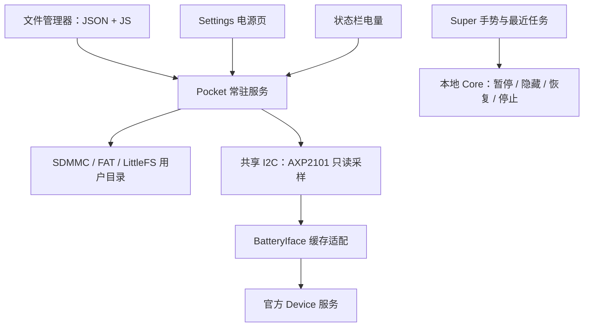

# 文件、电源与最近任务

2026-10-14 用户确认截图最近任务与手势导航实机效果满意，相关功能已记录到根目录 `COMPLETED.md`。独立文件管理包仍保留为开发源码，未预装。

后续发现 Settings 偶发打开为纯色，进入最近任务后再点卡片可恢复。已修复 Core START 没有恢复缓存页面可见性的缺陷：成功启动后显式显示当前内容页及标题栏，与 RESUME 一致；不改变暂停页在Stack重排时保持隐藏的策略。此补丁仍待实机复测，日志新增 `App screen visibility`，包含应用ID、screen与visible。

## 使用方式

本次按用户要求取消文件管理器预装，桌面不再显示 Files。`examples/file-manager` 开发源码保留，下面的文件操作说明仅描述独立开发包，不属于当前固件已开放的功能。内部入口是 `/littlefs/user`，SD 入口是 `/sdcard`；不会自动格式化卡。

文件列表每页 6 项，一个目录最多读取 512 项。点一次选中，再点一次目录进入；支持返回父目录、新建目录、重命名、文件复制、删除文件或空目录。删除按钮要连续点击两次确认；其他操作会取消确认。复制使用固件后台任务，应用显示进度；复制期间拒绝其他文件操作及安全移除。目录递归复制、非空目录删除、媒体预览不在首版范围内。

复制：选中文件 → 复制 → 打开目标目录或另一存储 → 粘贴。目标同名文件不会被覆盖。复制失败会尝试清理不完整目标文件。

SD 提供「安全移除」。重新插入后再点 SD 连接；没有卡检测引脚，不宣称立即自动热插拔。平时约 5 秒检查卡状态，文件操作也检查状态。写入中强拔仍可能损坏 FAT 或当前文件。

Settings 首页新增「电源与电池」，显示电量、充电/充满状态、有效时的电压与低电量提示。可选保持常亮、30/60/120/300 秒无触摸后息屏，保存在 NVS。息屏只关闭背光，系统与声音继续运行。第一次触摸只唤醒，不点击底下应用；唤醒恢复原亮度。

电源入口已改为与Wi-Fi、声音等相同的默认菜单项：左侧绿色电池图标、标题、右侧箭头，使用官方导航模板的行高、间距、按压反馈和明暗主题。入口放在主设置列表末尾，屏幕较小时可随列表滚动。

状态栏显示电量百分比，`+` 表示充电，`!` 表示低于或等于 15%。无法取得可信读数时显示 `--%`。PMIC 的供电轨、充电电流与充电电压保持原配置；电压 ADC 未启用或读数不合理时不展示电压。此版没有深度睡眠、关机或电源键接入。

底部快速上滑约60px后松手：回桌面、保留应用。上滑达到约96px后停留约450ms：打开最近任务。最近任务按微雪旧版 Phone 的逻辑显示横向截图卡片：左右滑动切换并居中吸附，点击恢复原页面，向上推超过阈值关闭该应用，短滑回到原位置；底部「全部关闭」停止列表里的应用。面板内从屏幕底部上滑或侧滑可收起面板。最多保留3个非桌面应用。明暗主题分别配色，截图保持截取时的原色。

回桌面或打开最近任务前，在应用 `on_pause` 后、界面隐藏前截取应用页面及其标题栏；不截入桌面、系统状态栏或系统弹框。截图是静态预览，不是后台实时刷新画面。320×480 时每张 RGB565 原始截图约300KiB，三张约900KiB，另有卡片对象及绘制开销；同尺寸截图复用缓存，关闭应用释放缓存，当前显示卡片移除后释放最后引用。截图失败时显示「预览不可用」，应用仍可恢复。卡片尺寸沿用微雪320×480配置的180×302（截图180×270），间隔40，圆角20，并按屏幕尺寸缩放。

垂直拖动已去掉距离限制，整张卡片可跟随手指上移或下移到屏幕边缘；关闭阈值仅用于松手判定。拖动时将卡片暂时移到全屏host，避免被原容器裁剪；达到上推阈值后松手关闭，不先弹回原位，下拉或短滑松手复位。左右切换逻辑保持独立。

左右屏幕边缘向内滑约48dp：返回前台应用上一级。侧边出现跟手箭头，达到返回阈值变蓝，松手消失；箭头适配明暗主题。边缘透明触摸条拦截应用按钮，避免返回时误点。键盘或消息对话框先处理返回；最近任务/快捷面板中的侧滑先收起面板。边缘区按32dp判定（限制20–40px），避开顶部和底部，要求横向位移大于纵向位移；普通应用内部横滑不作为系统返回。应用启动动画期间忽略导航手势，避免启动点击被解释为回桌面。

桌面常驻系统状态栏；应用里顶部轻触显示系统状态栏，约1.5秒自动隐藏；从顶部下拉打开全屏快捷面板，明确收起后恢复应用。Settings自身的标题/返回栏属于应用页面，随页面保留。

## 架构与接口



`components/pocket_platform` 是产品板级组件；公开 C++ 接口在 `include/pocket_platform.hpp`。Files清单在顶层声明 `"services":[{"name":"Pocket","version":"1.0.0"}]`，JS通过 `brookesia.start_service('Pocket')` 绑定，再调用 `Request`，参数是 `{Request:{Op:...,Path:...}}`。操作包括 `Volumes`、`Mount`、`Eject`、`List`、`Mkdir`、`Rename`、`Remove`、`Copy`、`CopyStatus`、`Power`。失败返回 `{ok:false,error:...}`；文件应用使用异步调用，避免挂载/枚举阻塞界面。

本服务只允许内部 `/littlefs/user` 与 SD 路径，隐藏系统资源、应用运行目录、NVS 和固件。内部总容量包含整个 LittleFS 分区，并非只计算用户目录。SD 由 Pocket 管理，不注册为 Core 的动态应用安装卷；默认安装位置固定内部 Flash。文件应用卸载/关闭不会卸载 SD，也不会中断已启动的复制任务。

文件应用源码在 `examples/file-manager/src`，当前主工程不再 staging 此包；配置工程时清理生成目录 `littlefs/apps/net.0use.files`，不会删除开发源码或 SD 卡内容。生成的 LittleFS 只预装桌面与 Settings，不预装 Files 或计数器。重新烧录 LittleFS 会替换设备内该分区的原内容。

为保留应用界面，本版增加了本地 `components/brookesia_system_core`，官方 `.reference` 不变。Core 把应用界面挂到 Stack 层，暂停时隐藏各个当前 screen-flow 根节点，恢复时重新显示。框架已有的定时器派发在 Paused 状态不调用应用；暂停不代表强制冻结应用自己创建的 FreeRTOS 任务或第三方回调。应用应在 `on_pause/on_resume` 中处理自己的活动。

本地 `components/brookesia_gui_lvgl` 基于官方0.8.5，修复Stack重排时无条件取消屏幕隐藏的问题，挂载时保留逻辑hidden状态。Super切到应用时隐藏Launcher主体，保留系统覆盖层；从卡片/Launcher激活应用走统一路径，先暂停旧前台。Running应用重新激活不重复调用on_resume。

截图钩子是 Core 的 `on_app_snapshot`，默认无操作；本地 Super 调用 LVGL Backend 的截图缓存与原生卡片接口。卡片事件经 GUI runtime 转发到 Shell 的应用输入线程，避免在持有 LVGL 锁时同步停止/恢复应用；刷新面板时递增代次，忽略旧卡片排队的事件。暂停保留应用界面、JS 环境和变量，不强制冻结自建任务；关闭时卸载 JS runtime，重新打开创建新环境，避免重复声明全局 `let gui` 导致 `SyntaxError: redeclaration of 'gui'`。不同应用自己的 `on_pause` 仍可选择停止业务活动；框架派发的应用定时器在 Paused 时不执行，与自建 FreeRTOS 任务不同。

微雪旧版参考位于 `ESP32-P4-WIFI6-Touch-LCD-3.5/examples/esp-idf/11_esp_brookesia_phone/components/brookesia_core`：Base Manager 的暂停/截图/关闭、Base App 的保留屏幕，以及 Phone Manager 与 `widgets/recents_screen` 的手势和卡片。这里迁移其行为到新版 Core/Super/LVGL 后端，未修改旧版示例或 `.reference`。新版组件本身不自带这套产品扩展。

统一返回动作是 `system.navigation.back`，只发送给前台应用。Settings 复用自身页导航；文件管理器返回父目录。JS 应用可订阅该动作，在根页面返回字符串 `navigation.home`；本地 Core 将它交给 Super 回桌面。C++ 应用对应返回 `std::unexpected("navigation.home")`。没有适配返回的运行时应用会回桌面；原生应用可沿用 IApp 的默认实现。

```js
// on_start 中订阅。
brookesia.call_function(gui, 'SubscribeAction',
  JSON.stringify({Action:'system.navigation.back'}));
// on_action 中处理。
if (action === 'system.navigation.back') {
  if (isRootPage) return 'navigation.home';
  showParentPage();
  return true;
}
```

## 构建、更新与验证

在仓库根目录执行：

```powershell
node tools/test-file-manager.cjs
python tools/check-device-integration.py
python tools/test-pocket-navigation.py
python tools/test-phone-recents.py
powershell -ExecutionPolicy Bypass -File tools/build-pocket.ps1
python tools/package-file-manager.py
```

`build-pocket.ps1` 使用本机已安装的 ESP-IDF 6.1 与 Python 环境，不烧录设备。`package-file-manager.py` 生成自用的无签名开发 BPK：`examples/file-manager/dist/net.0use.files-1.0.0.bpk`。后续改同 ID 的应用版本/代码，再生成 BPK，经已有 BPK 安装通道替换。更换包会重建应用实例，不保留当次运行的目录选择。

烧录导出位于 `examples/brookesia-minimal/build/bootloader/bin`。本次修改了主固件和 LittleFS，必须同时更新 `ouse_brookesia_minimal.bin`（`0x10000`）和 `littlefs_data.bin`（`0x810000`）。首次或更换分区布局时仍使用导出的完整四文件。重烧 LittleFS 会重置分区里的应用与文件，已有数据应先备份。

独立文件包行为测试覆盖目录返回、删除确认、异步请求等开发逻辑；静态检查核对资源/动作/依赖。`test-pocket-navigation.py` 检查真实后端挂载方法的隐藏/恢复；`test-phone-recents.py` 使用项目实际 LVGL 软件渲染器，验证截图像素、标题栏合成、场景恢复、截图复用/释放、卡片渲染、明暗色、返回箭头，以及真实指针输入下的点击恢复、左右切换、上推关闭与全部关闭事件。固件编译结果见 `build/build-agent.log`。这些检查不能代替屏幕、触摸和帧率的实机验收。

实机验收顺序：

1. 启动桌面和 Settings，Files 与计数器不出现；开屏动画和下拉快捷面板仍正常。
2. Settings 打开二级页面，回桌面后重新打开保持原页；侧滑箭头跟手，返回上一级，根页返回桌面。
3. 电池与插拔 USB 后的充电状态、电量未知时的降级；30 秒息屏，首次触摸只唤醒且亮度不变。
4. 上滑停留打开最近任务，松手后面板保持，Settings 截图包含标题栏；点击卡片回原页，上推关闭，再次打开正常。
5. 分别测试明暗主题；安装额外可信应用后检查左右切换、关闭正确卡片、全部关闭和后台状态保留。检查键盘优先返回和启动动画期间忽略导航。
