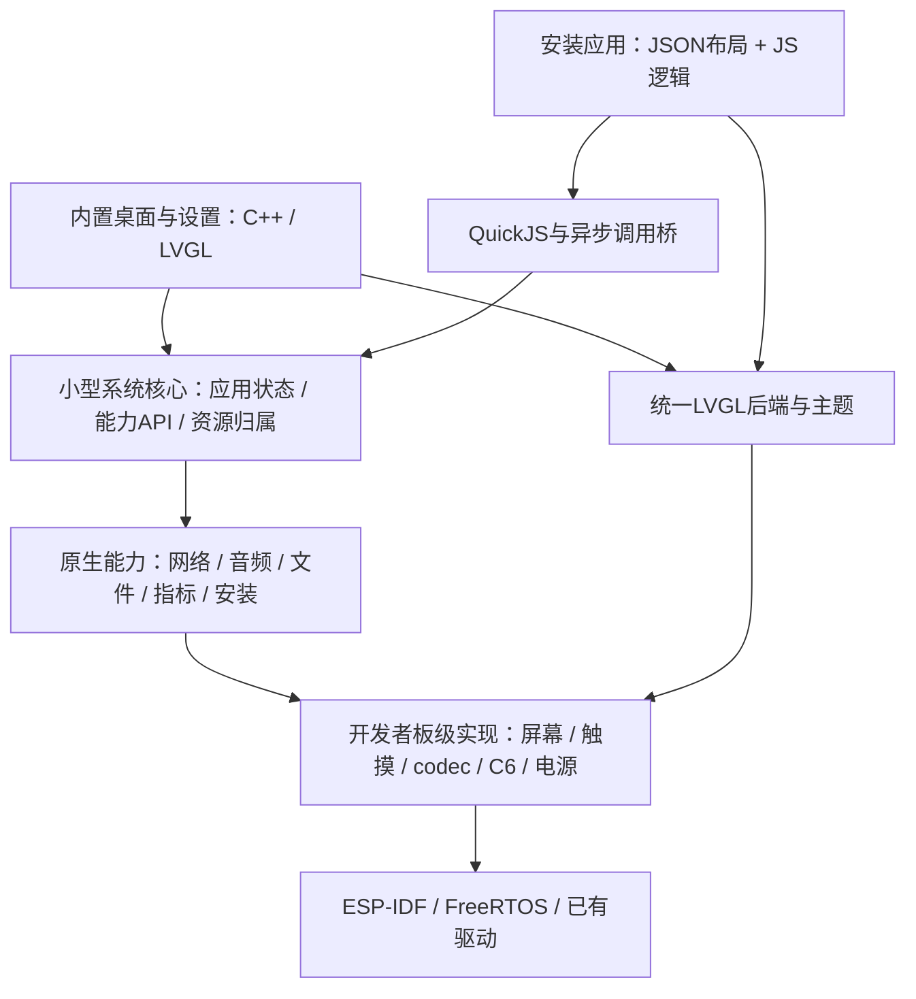

# OusePocket 轻量多媒体框架方案评估

日期：2026-10-15。状态：方案建议，尚未批准实施迁移；本轮未改运行代码、编译或操作板子。

## 评估结论

可行，且“一个默认桌面、一个内置设置、只安装JSON+JS应用、开发者自行实现板级接口”的范围，
比当前通用Brookesia集成更适合这个产品。建议建设固定范围的小框架，按模块抽取和验证已有代码。
大量功能行为、资源和应用代码可以参考/复用，但不能把Core/Super/ServiceManager直接拷贝并改名视作完成简化。

收益主要是依赖、启动任务、共享状态和生命周期分支减少；不保证原Core1故障自然消失。
当前根因未确认。最近两处编译错误分别为产品新增喂狗调用漏声明、启用U64统计后未适配上游32位样本指针，
是具体集成缺陷，不能统一解释成Brookesia适配板子过多。

官方当前主线v0.8明确为持续开发，覆盖HAL、服务、多运行时、GUI、系统和应用生态；
复杂性还来自产品目标广，不只来自硬件适配。上述定位有官方README支持，具体稳定性仍需本板实测。

## 范围和边界

首版支持ESP-IDF、FreeRTOS、LVGL及JSON+JavaScript动态应用；先支持现有微雪P4/C6板。
框架定义硬件契约，板级仓库提供实现，产品显式选择实现，不做自动扫描设备插件或通用板型发现。
今后可以适配其他板，但不能为尚不存在的板子提前建立多层抽象。

默认开机直接出现图标桌面，仅内置设置应用；应用列表来自安装管理器。
安装、卸载、设备信息和开发连接入口放在设置中，不要求额外内置商店/文件管理应用。
音乐、资源监视等作为JSON+JS包安装。CPU/内存、音频和存储后端仍由固件提供。

内置桌面/设置为固件系统组件，不受“可安装应用只支持JSON+JS”的限制。
桌面是系统壳，系统还包括包管理、生命周期、能力接口、存储和资源清理。

首版不做ELF/Lua/WASM后端、多窗口、任意后台JS、动态原生插件、通用服务反射或完整安卓兼容。
Android风格指交互外观，不意味着Android应用、进程隔离或系统能力兼容。

## 建议分层

显示、音频、网络等能力在图中是职责划分，不意味着每一项都新建一个线程或通用服务组件。

### 板级实现

框架给出Display、Touch、Backlight、Audio、Microphone、Network、Bluetooth、Storage、System/Power契约。
开发者在板级仓库实现并一次性注册：初始化/关闭、支持范围、同步或异步约定、错误和资源所有权。
缺少的可选硬件报告不支持，已注册但初始化失败的硬件报告故障，两者不要混淆。

显示绑定需要分辨率、像素格式、绘图缓冲、flush提交和DMA完成通知；触摸绑定坐标读取与旋转映射；
还需要LVGL时基和持续执行timer handler。完成后LVGL可以绘制和处理触摸。
Wi-Fi、音频、蓝牙不由LVGL处理，仍通过系统能力调用原生驱动。

当前板的ST7796/FT6336 BSP与显示、ES8311适配代码可作为迁移输入，生命周期/回调/缓冲归属需重新核对。
P4无线由C6协处理器提供，简化框架不会消除Hosted/SDIO和Wi-Fi/BLE固件兼容问题。

### 内置桌面和设置

建议首版桌面、设置使用C++直接创建LVGL控件，并共享主题、字体和基础控件。
开机不创建JS运行时，确保JS应用损坏时仍能回到桌面、打开设置和卸载应用。
JSON+JS最终同样绘制为LVGL控件，区别是布局和行为由谁解释执行。

设置采用设置项注册表，定义稳定ID、名称/图标、控件类型、范围、可见条件、读取/写入和变更事件。
首版支持开关、滑块、选项、信息行、入口页，复杂项目可注册原生自定义页面。
开发者可配置分类、顺序、启用项、主题、默认值；缺少BLE时不显示可操作的蓝牙开关。
偏好存储统一处理，拖动亮度/音量滑块不应每次都写Flash。
后续若有需要，再增加第三方JSON+JS设置扩展，不把它作为首版依赖。

当前Brookesia设置实际是C++行为加JSON界面资源，并不是纯JS。
现有主题、图标、翻译和页面内容可迁移，但C++行为绑定了Brookesia服务，不可直接视为独立组件。

桌面默认可用，允许主题和布局参数配置；完全替换桌面通过产品编译时接口完成。
首版不再要求每个板级项目重写状态栏、启动器、返回导航和应用图标管理。

### 动态应用与原生能力

单一QuickJS后端，JSON描述控件和布局，JS处理交互与业务。
媒体解码、PCM流、视频、录音、网络和大文件操作留在原生能力中，JS传路径、参数和控制命令。
音量/音效/录音共享同一音频资源管理，后台播放不要求播放器JS一直运行。

首版只保留一个前台JS应用。应用离开前台时暂停UI定时器；后台播放交给原生Audio。
系统记录应用拥有的界面、定时器、订阅、文件和请求，关闭时统一清理。
JS执行设置时间预算、堆上限和栈上限；原生操作独立设置超时，JS超时不能替代原生任务取消。

JS返回与LVGL更新通过队列交接；外部事件不直接在驱动回调或其他任务中操作LVGL。
所有业务UI对象由一个UI任务管理，JS在自己的任务中串行执行，耗时工作使用有限原生工作队列。
DMA完成等遵循LVGL官方允许的例外；不把所有硬件都强制改成无中断或一任务。

需要明确停止代次：应用关闭后，迟到的结果不能访问已释放的JS上下文或LVGL对象。
这些约束即使去掉Brookesia也仍然必须实现，是框架稳定性的核心工作。

### 固件与应用接口匹配

系统暴露明确版本的能力清单，至少包含UI、设置、文件、音频和系统指标等实际实现状态。
应用manifest记录最低宿主API版本和必需能力；安装/启动时检查，缺少接口立即提示。
不是仅校验某个服务名称和版本存在，就推断它的所有操作都已实现。
本次资源监视遇到的“固件没有ResourceSnapshot但BPK能安装”应在这层直接阻止。

所有异步请求必须有可见的成功/失败/超时结果及请求归属，错误统一对象格式。
CPU指标未开启时应返回明确不可用状态，不能伪装为0或无限“统计中”。
JSON+JS打包工具、模拟器、设备端能力定义使用同一份版本化契约。

### 应用安装与电脑开发

保留BPK容器和现有应用资源组织，先审计manifest、API和GUI子集的兼容性。
保留包大小/文件数量限制、路径校验、完整性校验、暂存安装、旧版本保留和断电恢复元数据。
USB上传与网络下载共用同一个安装器，不能分别实现安装规则。
卸载先停止并清理应用，包与用户数据分开处理。

PC开发闭环首版包括：同一JSON解析器/JS逻辑、模拟硬件API、日志/异常、截图、上传安装、停止后重载。
模拟器通过不代表板上DMA、内存或网络已验收。
JS断点调试属于额外的引擎/协议集成，不能把串口日志与热重载宣传成完整断点调试器。
商店首页和云后台后续再做；基础框架先支持本地上传和按URL下载。

## 代码迁移判断

| 对象 | 建议 | 主要工作 |
| --- | --- | --- |
| ESP-IDF、BSP、codec/文件系统驱动 | 直接继续使用，固定版本 | 核对生命周期和内存配置 |
| 板级显示/触摸/音频适配 | 保留可验证部分 | 改接新契约、清楚定义DMA缓冲与回调归属 |
| Music/Resources等JSON、JS、图标和翻译 | 优先迁移 | API兼容垫片或修改少量宿主调用 |
| BPK格式、包校验和工具 | 保留协议、抽取实现 | 去掉服务依赖，补故障恢复与兼容检查 |
| JSON到LVGL的控件、样式和资源映射 | 优先抽取 | 对依赖做闭包检查；原样链接可能带回整个GUI框架 |
| QuickJS引擎 | 继续使用 | 精简宿主桥、保留资源限制、补执行时间预算 |
| Brookesia现有JS Backend | 参考异步和生命周期逻辑 | 依赖RuntimeManager/HostBridge/调度器，不宜整块复制 |
| Core/Super/通用ServiceManager/HAL注册体系 | 按职责重写为小模块 | 否则会把当前依赖关系重新带回来 |
| 桌面和设置 | 复用外观资源与交互 | 原生实现，改接简单能力接口 |
| 其他运行时、AI集成、MCP、跨平台HAL插件 | 不进入首版 | 将来有具体需求再评估 |

不能在未做依赖清理、固件体积/内部堆/任务数对比前承诺“复用80%”或“内存省一半”。
最容易复用的是应用和资源，真正需要重整的是系统编排与调用链。
若抽取GUI仍拖入大量原依赖，可先支持实际应用用到的控件子集，保留已支持的JSON语义并明确报告未支持项。
未来要独立维护抽取代码、补丁和版本升级，复用时保留原许可证与来源记录。

## 对现有问题的影响

| 问题 | 简化框架的作用 | 仍须验证 |
| --- | --- | --- |
| 固件/应用接口不匹配、一直读取中 | 能力检查和统一超时可直接改善 | 真实Promise完成、错误显示和关闭后晚回调 |
| 服务多、锁多、任务栈难管理 | 显式模块和有限队列减少状态组合 | 网络/媒体/驱动自带任务仍存在 |
| 编译时类型与私有API兼容问题 | 缩小依赖可减少碰到的接口面 | SDK更新和产品代码仍可能出错 |
| 开机大量功能同时启动 | 常驻原生壳、JS/媒体按需开启可减少启动压力 | 显示/存储/无线初始化顺序和内存占用 |
| Core1 Load access fault | 简化工程有利于定位与隔离 | 根因未定；不能承诺迁移即解决 |
| DMA、PSRAM/cache、供电、SDK/驱动问题 | 小框架可提供更清晰复现 | 并不会随服务框架移除而自动修复 |

## 推进路线与决策门槛

1. 保留现有工程和诊断证据，固定SDK/BSP/芯片版本，建立独立最小固件目录，暂不迁移主系统。
   先实现显示、触摸、背光、存储、指标，核对400MHz/PSRAM200/XiP与原工程一致的对照。
   若最小板级工程仍有同类访问异常，先查SDK/驱动/硬件，不能把应用迁移当修复手段。
2. 加原生默认桌面、设置、主题/语言及能力表。验收开机直接可用、软重启/冷启动和设置持久化；
   此时不启动JS和应用安装服务，记录内部堆、最大块、任务数及启动时间。
3. 加单个QuickJS应用和JSON UI，用计数器与资源监视验证完整调用链。
   验收死循环预算、内存上限、缺失能力、原生超时、前后台、关闭后迟到回调及资源回收。
4. 加BPK安装/卸载/更新、USB及PC预览，先跑一个上传/中断/恢复/重载闭环，再加网络下载。
   同时验证长时间USB空闲没有高频忙轮询。
5. 迁移音乐并检验后台原生播放与应用退出；随后再按实际需要加入麦克风、BLE和其他多媒体能力。

每阶段记录证据后再增加下一层，避免一次移入网络、音频、JS、安装器而无法定位回归。
验收同时观察panic、看门狗、分配失败和内存趋势，不能仅以“进入桌面一次”认定稳定。
首版范围应固定，否则重新加入通用服务、多运行时、多桌面插件后会逐渐恢复原复杂度。

## 官方依据

- [Brookesia架构、组件和版本定位](https://github.com/espressif/esp-brookesia)
- [System Core职责](https://docs.espressif.com/projects/esp-brookesia/en/latest/system/core/index.html)
- [LVGL与硬件连接](https://lvgl.io/docs/open/9.4/details/integration/overview/connecting_lvgl.html)
- [LVGL线程规则与单一GUI任务](https://docs.lvgl.io/9.4/details/integration/overview/threading.html)
- [QuickJS内存、栈和执行中断接口](https://bellard.org/quickjs/quickjs.html)

本地核对：waveshare_display.cpp、waveshare_audio.cpp、pocket_resources.cpp、原生Settings实现、
SystemHostBridge、Runtime JS backend、JSON/LVGL后端、BPK安装与校验代码。
上述建议是基于这些依赖的工程判断，不是已经完成的迁移或性能实测。
